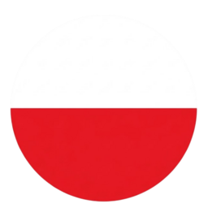

#  Restaurant System 

> System zarządzania restauracją — panel kelnera, panel kucharza i panel konfiguracji.  
> Restaurant management system — waiter panel, chef panel and configuration panel.

---

##  Opis projektu (Polski)

**Restaurant System** to aplikacja webowa stworzona dla restauracji, która ułatwia codzienną pracę zespołu.  
Łączy trzy panele:

- **Panel Kelnera** — obsługa stolików, zamówień, koszyka i płatności.
- **Panel Kucharza** — kolejka dań do przygotowania, oznaczanie dań jako gotowe, historia kuchni.
- **Panel Konfiguracji** — zarządzanie menu, kategoriami, pracownikami, stanowiskami, stolikami/piętrami i ustawieniami restauracji.

###  Co można zrobić?

- 🪑 **Stoliki i piętra** — dodawanie/usuwanie pięter i stolików, ustawianie liczby krzeseł.
- 📋 **Menu i kategorie** — tworzenie kategorii (np. Drinks), dodawanie dań z ceną i opisem, przypisywanie dań do kategorii.
- 🧾 **Zamówienia** — kelner otwiera stolik, dodaje dania do koszyka, wysyła zamówienie do kuchni, odbiera gotowe dania.
- 👨‍🍳 **Kuchnia** — kucharz widzi dania do przygotowania, przejmuje je i oznacza jako gotowe; historia aktywności w kuchni z filtrowaniem.
- 💳 **Płatności** — zamykanie rachunku, płatność, zwalnianie stolika.
- 👥 **Pracownicy i stanowiska** — zarządzanie kontami, uprawnieniami i dostępem do paneli.
- 📊 **Historia** — historia zamówień (kelner) i historia kuchni (kucharz) z filtrami (data, godzina, zakres czasu, danie, pracownik).
- ⚙️ **Ustawienia** — nazwa restauracji, logo.

---

##  Project description (English)

**Restaurant System** is a web application built for restaurants to streamline daily operations.  
It consists of three panels:

- **Waiter Panel** — table handling, orders, cart and payments.
- **Chef Panel** — cooking queue, marking dishes as ready, kitchen history.
- **Config Panel** — management of menu, categories, employees, positions, tables/floors and restaurant settings.

###  What can you do?

- 🪑 **Tables and floors** — add/remove floors and tables, set number of chairs.
- 📋 **Menu and categories** — create categories (e.g. Drinks), add dishes with price and description, assign dishes to categories.
- 🧾 **Orders** — waiter opens a table, adds dishes to cart, sends order to kitchen, picks up ready dishes.
- 👨‍🍳 **Kitchen** — chef sees dishes to prepare, claims them and marks as ready; kitchen activity history with filters.
- 💳 **Payments** — close bill, pay, free table.
- 👥 **Employees and positions** — manage accounts, permissions and panel access.
- 📊 **History** — order history (waiter) and kitchen history (chef) with filters (date, time, time range, dish, employee).
- ⚙️ **Settings** — restaurant name and logo.

---

## 🛠️ Technologie / Technologies

- **Backend:** PHP (PDO, MySQL/MariaDB)
- **Frontend:** HTML, CSS, JavaScript
- **Database:** MySQL / MariaDB
- **Server:** Apache (XAMPP)

---

## 📁 Struktura / Structure

```
Restaurant_System/
├── client/
│   ├── chef_panel/
│   ├── waiter_panel/
│   ├── config_panel/
│   └── index.php
├── php/
├── installation/
└── README.md
```

---

## 🚀 Uruchomienie / Running

1. Skopiuj projekt do katalogu serwera (np. `htdocs`).  
   Copy the project into your server directory (e.g. `htdocs`).
2. Zaimportuj bazę danych z `installation/restaurant_system.sql`.  
   Import the database from `installation/restaurant_system.sql`.
3. Skonfiguruj połączenie w `php/db.php` (host, nazwa bazy, użytkownik, hasło).  
   Configure the connection in `php/db.php`.
4. Otwórz w przeglądarce: `http://localhost/Restaurant_System/client/index.php`  
   Open in browser: `http://localhost/Restaurant_System/client/index.php`

---

## 📄 Licencja / License

 Projekt do portfolio. / Portfolio project.
